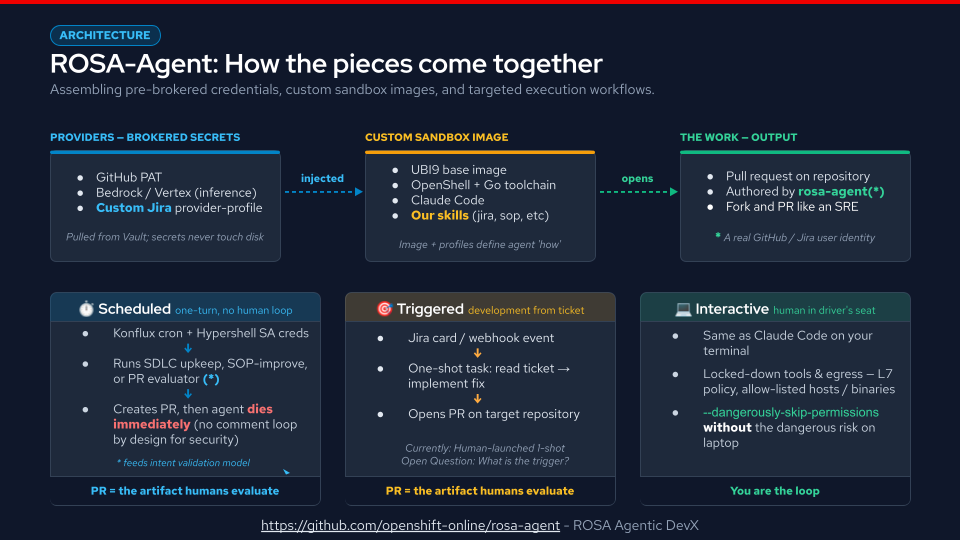

# ROSA-Agent



ROSA-Agent is a HyperShell gateway and a collection of service accounts and provider credentials for automating ROSA agentic tasks, including recurring scheduled repository maintenance, automated feature implementation and human-interactive sessions. It is owned and maintained by the [ROSA Agentic DevX](https://github.com/openshift-online/rosa-agentic-devx) team.

* Scheduled jobs are plain `batch/v1` CronJobs applied directly to the `rosa-agent-stage` namespace (see [docs/JOBS.md](docs/JOBS.md))
* Automated feature implementation are one-shot, non-interactive ("Read this Jira and implement it")

## Open Questions

What triggers are available?

Currently:

* Plain `batch/v1` CronJobs (applied directly to the cluster, not via Konflux) using HyperShell Service Account credentials
* Human interactive and non-interactive with OpenShell CLI

Future:

* Jira NEW card creation?
* Webhook?
* Chai-bot/Slack?

## UBI9 Base Image

The sandbox image (`Containerfile`) is a multi-stage build on the Red Hat `registry.access.redhat.com/ubi9/ubi:9.8` base image rather than the Ubuntu-based NVIDIA OpenShell-Community image. Even so, it inherits the OpenShell scaffold from the NVIDIA base image — the agent skills (e.g. `github/SKILL.md`) are extracted via `COPY --from` and merged with our own skills under `/sandbox/.agents/skills/`, and the build mirrors the NVIDIA user model (supervisor + sandbox users, `HOME=/sandbox`, `/etc/openshell/policy.yaml`). On top of UBI9 it layers the `go-toolset` RPM and pinned Go tooling, Claude Code from Anthropic's signed RPM repo, and supporting CLIs (gh, golangci-lint, staticcheck, shellcheck), then pre-seeds Claude Code trust state and Vertex AI/Jira runtime defaults so the sandbox runs non-interactively. WDYT?

Future consideations should include perhaps a non-Golang/language Boilerplate [openshift/boilerplate](https://github.com/openshift/boilerplate) image scaffolding for building/maintaining.

## Jobs

Jobs are non-interactive, scheduled tasks the agent runs as plain `batch/v1` CronJobs
applied directly to the `rosa-agent-stage` namespace, bypassing Konflux, using a baked-in
skill that scopes the work. Job skills live under `sandbox/skills/`.

See **[docs/JOBS.md](docs/JOBS.md)** for the full list of jobs (what each one does, which
skill it wraps, failure handling), the CronJob deployment details (schedules, Service
Accounts, the `image-vuln-check` multi-target fan-out), and the Vault-injected credential
each one consumes.

## Hypershell Gateway
  
  <https://hypershell.apps.rosa.hcmais01ue1.s9m2.p3.openshiftapps.com/gateways/3I94YwZezpdI4AEzuxtJnsVYGVt>

* This gateway is owned by Chris Collins right now - there's no "shared" gateway at the moment.
* Service accounts are supported and created using the "Service Account" tab at the top
* Service accounts expire every 90 days

### Policies

Sandbox behavior is governed by a HyperShell policy file (`/etc/openshell/policy.yaml` in the
image). The default policy shipped in this repo lives at `policies/default.yaml`.

The default policy is a deny-by-default egress and filesystem policy — the sandbox can only reach
the hosts explicitly listed, and each rule pins the specific binaries allowed to make those calls.
It defines two things:

* **`filesystem_policy`** — includes the workdir, and grants read-write to `/tmp` and `/dev/null`.
    `/dev/null` must be declared explicitly, otherwise bash login shells fail silently when Landlock
    blocks `/etc/profile` redirections. Baseline paths (`/usr`, `/lib`, `/etc`, `/proc`, `/tmp`,
    `/dev/urandom`) are added automatically by the supervisor.
* **`network_policies`** — per-service egress allow-lists, each scoped to specific binaries
    (`/usr/bin/claude`, `git`, `gh`, `glab`, `go`, `curl`, `skopeo`) with `enforce` enforcement:
  * **Model inference** — Anthropic API (`api.anthropic.com`, for Claude Code WebFetch/WebSearch).
      Google Vertex AI endpoints are provided by the `google-vertex-ai` provider profile
      (attached via `--provider`); they are not declared in the baked policy to avoid endpoint
      ambiguity with the profile's auto-injected entries.
  * **GitHub** — read-write to `api.github.com` and `github.com`; read-only to
      `codeload.github.com`, `objects.githubusercontent.com`, and GitHub Actions hosts (CI status).
  * **GitLab** — read-write to `gitlab.cee.redhat.com` (git + `glab`).
  * **Go tooling** — read-only to `proxy.golang.org`, `sum.golang.org`, and `pkg.go.dev`, and to
      `storage.googleapis.com` (`proxy.golang.org` redirects module zip downloads here, needed for
      `go get`/`go mod download`/`go test`/`go build` on any module not already in the local cache).
  * **Container registry** — read-only to `quay.io` (Quay API for image manifest/vulnerability
      data via `curl`, and the registry v2 API for manifest/tag/label inspection via `skopeo`;
      no image pulls or pushes), to `s3.us-east-1.amazonaws.com` (quay.io's blob-storage
      backend redirects config-blob fetches here, needed for `skopeo inspect` to read OCI labels),
      and to `registry.access.redhat.com` (same `curl`/`skopeo` manifest/label inspection, needed
      to verify a candidate Red Hat base-image tag contains a patched RPM before a CVE
      remediation PR is opened).
  * **Red Hat errata / security data** — read-only to `access.redhat.com` (confirming which
      erratum/release fixes a given CVE) and `security.access.redhat.com` (CSAF/VEX advisory
      data), both via `curl`, needed for the same base-image CVE verification.
  * **Reference / CI** — read-only to Red Hat docs, Konflux, Codecov, and Prow.

Note: Jira egress is intentionally **not** in this baked policy. The `atlassian-jira` provider
profile composes its own endpoints with two-writes-only (comment + remotelink) method/path
enforcement; a coarse read-write block here would union over and defeat that restriction. Attach
the Jira provider to grant Jira access rather than adding it to the policy. WDYT?

Note: PagerDuty egress is intentionally **not** in this baked policy either, for the same reason.
The `pagerduty` provider profile composes its own read-only incidents/alerts + notes-write-only
allow-list; PagerDuty's API has no separate scope for "notes write" vs. "incident write", so that
split only exists at this profile's L7 rules — a coarse block here would defeat it just as surely.
Attach the pagerduty provider to grant PagerDuty access rather than adding it to the policy.

### Provider Profiles

Provider profiles are custom OpenShell provider definitions that declare how a credential is
injected into a sandbox and, for `rest`-type providers, exactly which endpoints/methods/paths the
sandbox proxy will allow. They are stored in this repo under `provider-profiles/` and imported with:

```bash
openshell provider profile lint -f provider-profiles/<profile>.yaml
openshell provider profile import -f provider-profiles/<profile>.yaml
```

Currently there are three profiles:

* **`google-vertex-ai.yaml`** — Google Vertex AI inference for Claude Code. Based on the stock
    `google-vertex-ai` profile with two edits: `binaries` set to `[/usr/bin/curl, /usr/bin/claude]`
    (the stock profile has none, so every connection is denied), and
    `allow_uninspected_credentials: true` on aiplatform endpoints (disables the body marker guard
    that otherwise denies requests containing credential-placeholder literals from conversation
    history -- safe because `request_body_credential_rewrite` is `false`, so no secret is ever
    substituted into the body).

* **`atlassian-jira.yaml`** — Jira Cloud access for sandboxed agents, with a deliberately narrow
    allow-list:
  * **Reads** — everything under `GET /rest/api/3/**` and `GET /rest/agile/1.0/**` (get issue,
      comments, transitions, editmeta/createmeta, field IDs, projects, and `/myself`), plus
      unauthenticated `GET /_edge/tenant_info` for cloudId discovery.
  * **Writes** — enumerated explicitly and narrowly: JQL search (`POST .../search/jql`), create
      issue, edit issue, comment, add remote (web) link, transition, and self-assign. Deletes, bulk
      operations, attachments, worklogs, watchers/votes, issue links, and admin endpoints are
      intentionally excluded — add them as explicit rules only if a real need arises, rather than
      widening POST/PUT with a catch-all.
  * Rules are declared twice: once for the classic site host (`redhat.atlassian.net`) and once for
      the API-gateway host (`api.atlassian.com`, prefixed with `/ex/jira/{cloudId}`) required by
      scoped tokens.
  * **Credentials/config** — only `JIRA_API_TOKEN` is a secret managed by the profile; it becomes
      an opaque, proxy-resolved placeholder inside the sandbox. `JIRA_EMAIL` and `JIRA_BASE_URL` are
      **not** secrets and must be passed as plain `--env` values at sandbox creation time (custom
      profiles have no mechanism to expose `--config` values as sandbox env vars).
* **`pagerduty.yaml`** — PagerDuty access for sandboxed agents: read-only incidents/alerts, plus
    read/write incident notes. See the [PagerDuty](#pagerduty) section below for the full scope and
    why the read/write split is enforced entirely by this profile's allow-list rather than by
    PagerDuty itself.

### HyperShell Service Account

Service account can be created with:

```bash
hypershell service-account create \
  --gateway-id <gateway_id> \
  --name <account_name> \
  --description <description> \
  --role <openshell-user | openshell-admin> \
  --expiration <time>
```

Service Account CLI:

```bash
if [ -z "${OPENSHELL_OIDC_CLIENT_SECRET:-}" ]; then
  OPENSHELL_OIDC_CLIENT_SECRET=$(vault kv get -mount=osd-sre -field="hypershell-oidc-client-secret" rosa-agent)
  export OPENSHELL_OIDC_CLIENT_SECRET
fi

openshell gateway add \
  --name 'ROSA Agentic Devx-rosa-agent' \
  --oidc-issuer https://keycloak-ambient-keycloak.apps.rosa.hcmais01ue1.s9m2.p3.openshiftapps.com/realms/ambient-code \
  --oidc-client-id hs-sa-3I94YwZezpdI4AEzuxtJnsVYGVt-3J3ccZA4F2wyrrGaIHorqtywaiL \
  --oidc-audience 'ROSA Agentic Devx-3I94YwZezpdI4AEzuxtJnsVYGVt' \
  https://gw-openshell-46b2dff2b7232948.openshell.stage.devshift.net:443

openshell -g 'ROSA Agentic Devx-rosa-agent' whoami --output json
```

```bash
if [ -z "${OPENSHELL_OIDC_CLIENT_SECRET:-}" ]; then
  OPENSHELL_OIDC_CLIENT_SECRET=$(vault kv get -mount=osd-sre -field="hypershell-oidc-client-secret" rosa-agent)
  export OPENSHELL_OIDC_CLIENT_SECRET
fi

ACCESS_TOKEN=$(printf '%s' "$OPENSHELL_OIDC_CLIENT_SECRET" | \
  curl --fail --silent --show-error --request POST https://keycloak-ambient-keycloak.apps.rosa.hcmais01ue1.s9m2.p3.openshiftapps.com/realms/ambient-code/protocol/openid-connect/token \
    --header 'Content-Type: application/x-www-form-urlencoded' \
    --data-urlencode 'grant_type=client_credentials' \
    --data-urlencode client_id=<client_id> $(vault kv get -mount=osd-sre -field="hypershell-oidc-client-id" rosa-agent)\
    --data-urlencode client_secret@- | \
  python3 -c 'import json,sys; print(json.load(sys.stdin)["access_token"])')
```

Service account config:

*NOTE:* This will overwrite your personal credentials for that gateway if you perform this task in the same
environment you use the `openshell` cli tool.  This is an OpenShell limitation - the paths are hard-coded.
You may prefer to work with service accounts in a container instead.

```bash
# Register gateway config for non-interactive use
GW_NAME="<gateway_name>"
GW_DIR="$HOME/.config/openshell/gateways/${GW_NAME}"

ISSUER='https://keycloak-ambient-keycloak.apps.rosa.hcmais01ue1.s9m2.p3.openshiftapps.com/realms/ambient-code' # HyperShell

ENDPOINT="<gateway_endpoint>" # From HyperShell Gateway-specific "details" tab
CLIENT_ID="<service_account_client_id>" # From HyperShell Gateway-specifc "service accounts" tab

mkdir -p "$GW_DIR"

# Write gateway metadata
cat > "$GW_DIR/metadata.json" <<EOF
{
  "name": "${GW_NAME}",
  "gateway_endpoint": "${ENDPOINT}",
  "is_remote": true,
  "gateway_port": 0,
  "auth_mode": "oidc",
  "oidc_issuer": "${ISSURER}",
  "oidc_client_id": "${CLIENT_ID}"
}
EOF
chmod 600 "$GW_DIR/metadata.json"

# Write the token
cat > "$GW_DIR/oidc_token.json" <<EOF
{
  "access_token": "${ACCESS_TOKEN}",
  "issuer": "${ISSURER}",
  "client_id": "${CLIENT_ID}"
}
EOF
chmod 600 "$GW_DIR/oidc_token.json"
```

Configuration can be validated with:

```bash
openshell -g $GW_NAME whoami
```

A working service account does NOT contain a `Name` field in the output.

```txt
Current User

  Subject: 4da987ed-f980-49ae-99f4-3d374126c4d6
  Provider: oidc
  Roles: openshell-user, openshell-admin
  Scopes: 
```

### Troubleshooting Service Account Issues

`Error:   × No such file or directory (os error 2)` when running a sandbox

This is likely the `openssh-clients` package missing from the execution environment.  Openshell uses ssh with a `ProxyCommand=/usr/bin/openshell` to securely communicate with a sandbox after creation, even when they are non-interactive (`--no-tty`).  No other SSH configuration is necessary other than installing the SSH Clients package.

`Error:   × ssh exited with status exit status: 255`

Ensure your JWT has refreshed right before running the command.  Theoretically it's a 300s TTL, but in practice it doesn't seem to behave like this.  Need more data.

### Refreshing your gateway token (interactive use)

Once a gateway is registered (see above), you interact with it directly through
the `openshell` CLI, `-g <gateway_name>`:

```bash
GW_NAME='ROSA Agentic Devx-rosa-agent'

openshell -g "$GW_NAME" whoami
openshell -g "$GW_NAME" sandbox create --name demo
```

The `client_credentials` access token in `oidc_token.json` is short-lived and
there is no refresh token — it must be re-minted. The
[`hack/refresh_openshell_token.py`](hack/refresh_openshell_token.py) helper
re-mints the token in place from the OIDC client secret, verifies with
`openshell whoami`, and optionally execs into an openshell command.

The script reads the client secret from the `OPENSHELL_OIDC_CLIENT_SECRET`
environment variable. If that variable is not set, it falls back to reading
from Vault automatically (prompting for OIDC browser login if your Vault
token is expired):

```bash
# Vault path: osd-sre/rosa-agent, field: hypershell-oidc-client-secret
# To set the secret explicitly (e.g. in CI or to skip the Vault fallback):
export OPENSHELL_OIDC_CLIENT_SECRET=$(vault kv get -mount=osd-sre -field=hypershell-oidc-client-secret rosa-agent)

# Or just let the script read Vault for you — it will prompt for OIDC
# browser login if your Vault token (~/.vault-token) is expired:
hack/refresh_openshell_token.py -g "$GW_NAME"
```

```bash
# Re-mint the gateway's token file and verify with whoami:
hack/refresh_openshell_token.py -g "$GW_NAME"

# Only re-mint if fewer than 90s of life remain:
hack/refresh_openshell_token.py -g "$GW_NAME" --if-expiring 90

# Refresh the token, verify with whoami, then exec into openshell.
# The script replaces itself with the openshell process (os.execv),
# so openshell gets the real TTY and signals:
hack/refresh_openshell_token.py -g "ROSA Agentic Devx-rosa-agent" \
  --exec -- sandbox create --name "${USER}-$(date +%s)" \
    --from quay.io/redhat-services-prod/rosa-tenant/rosa-agent/rosa-agent:latest \
    --provider vertex-a \
    --provider rosa-agent-github --provider rosa-agent-jira \
    --env JIRA_EMAIL="sd-sre-platform+rosa-agent@redhat.com" \
    --env=JIRA_BASE_URL="https://redhat.atlassian.net" \
    --no-keep --no-tty \
    -- claude --dangerously-skip-permissions --print "Ping"
```

It reads config (issuer, client id) from the gateway's `metadata.json`, so no
flags beyond `-g` are needed for a gateway registered as above. Run
`hack/refresh_openshell_token.py --help` for the full flag list (Vault
mount/path/field overrides, `--no-browser`, `--no-vault-login`, etc.).

## Github

* ROSA-Agent is a real user in Github: <https://github.com/rosa-agent>  
* Credentials, including 2fa, are stored in Vault: <https://vault.devshift.net/ui/vault/secrets/osd-sre>
* Github 2fa code generation is done with: `vault read totp/osd-sre/code/rosa-agent-github-2fa`
* OpenShift org membership is managed by DPP
* Openshift-Online org membership is managed in the `hybrid-platforms/org` repo in Gitlab.

### Token Considerations

* Fine-grainted tokens are preferred and need only `contents:read`, `issues:read&write` and `pull_request:read&write` but require approval by the ORG owners, and must be created in that org
* Classic PAT tokens work out-of the box with `repo` permissions (top-level check-box).  We're using this as a workaround until a fine-grained token is approved
  
Hypershell Provider config:

```bash
openshell provider create --name rosa-agent-github \
  --type github \
  --credential GITHUB_TOKEN
```

## Jira

Custom `Jira` skill is baked into the image to tell the sanbox agents how to read and comment on Jira cards.

Note: The source for that skill lives in this repo at `sandbox/skills/jira/SKILL.md`. It teaches the
sandbox agent to detect the token type (scoped Bearer against `api.atlassian.com` vs. classic Basic
against `redhat.atlassian.net`), derive the tenant cloudId, and call the Jira Cloud REST API through
a `jira` curl helper — staying within the reads/comment/remotelink operations the
[`atlassian-jira` provider profile](#provider-profiles) permits.

* ROSA-Agent is a real user in Jira: <https://home.atlassian.com/o/4k7c08c0-9kb0-1aca-k606-d1417cc24104/people/712020:866a7c2a-31c4-45eb-bcc5-7edceb696a97?cloudId=2b9e35e3-6bd3-4cec-b838-f4249ee02432>
* Credentials, including 2fa, are stored in Vault: <https://vault.devshift.net/ui/vault/secrets/osd-sre>
* Github 2fa code generation is done with: `vault read totp/osd-sre/code/rosa-agent-jira-2fa`
* The API Token expires every 90 days

Hypershell Provider config:

```bash
export JIRA_API_TOKEN=$(vault kv get -mount=osd-sre -field="jira-token" rosa-agent)
openshell provider create --name "rosa-agent-jira" \
  --type atlassian-jira \
  --credential JIRA_API_TOKEN \
  --config JIRA_EMAI="sd-sre-platform+rosa-agent@redhat.com" \
  --config JIRA_BASE_URL="https://redhat.atlassian.net"
```

Note: The `atlassian-jira` Provider Profile is a custom profile, defined in this repo at
`provider-profiles/atlassian-jira.yaml`. See the [Provider Profiles](#provider-profiles) section
for a summary of what it allows and how to import it.

```txt
Provider:

  Id: dc02f090-6396-4187-ae5a-df0436beac2b
  Name: rosa-agent-jira
  Type: atlassian-jira
  Resource version: 3
  Credential keys: JIRA_API_TOKEN
  Config keys: JIRA_EMAIL, JIRA_BASE_URL
```

Note: Sandboxes must be run with the Config keys as `ENV` variables.  There is no injection mechanism for Config keys in the Atlassian Jira provider config.

```bash
  --provider rosa-agent-jira \
  --env JIRA_EMAIL="sd-sre-platform+rosa-agent@redhat.com" \                                                          
  --env JIRA_BASE_URL="https://redhat.atlassian.net"      
```

## PagerDuty

Grants sandboxed agents read-only access to PagerDuty incidents and alerts, plus read/write access
to incident notes — e.g. to triage an active incident and leave a note with findings, without being
able to resolve, reassign, or otherwise mutate the incident itself.

PagerDuty's REST API v2 has no separate scope for "notes write" — a credential capable of writing
notes is, at the PagerDuty-authorization layer, also capable of general incident mutation
(`incidents.write` covers both). The read-only/notes-write split this integration actually enforces
lives entirely in the [`pagerduty` provider profile](#provider-profiles)'s method/path allow-list
(`provider-profiles/pagerduty.yaml`), the same way the Jira profile enforces its own write scope —
see the [Policies](#policies) note above.

Auth note: unlike Jira, this profile does **not** use a static API key. PagerDuty's classic
`Authorization: Token token=<key>` scheme can't be resolved by the sandbox proxy's placeholder
rewriter (it splits header values on the first whitespace, and `token=<placeholder>` isn't a
resolvable shape — see the comment at the top of `pagerduty.yaml` for the full explanation). Instead
the profile uses PagerDuty's Scoped OAuth client-credentials grant, which the gateway mints and
refreshes itself and sends as a plain `Authorization: Bearer <token>`.

Hypershell Provider config:

```bash
openshell provider create --name "rosa-agent-pagerduty" --type pagerduty

# Register (or reuse) a Scoped OAuth app in PagerDuty first (Developer Mode /
# App Registration, with Incidents read+write access) to get these values:
export PD_CLIENT_ID=$(vault kv get -mount=osd-sre -field="pagerduty-oauth-client-id" rosa-agent)
export PD_CLIENT_SECRET=$(vault kv get -mount=osd-sre -field="pagerduty-oauth-client-secret" rosa-agent)
openshell provider refresh configure rosa-agent-pagerduty \
  --credential-key PAGERDUTY_ACCESS_TOKEN \
  --strategy oauth2-client-credentials \
  --material client_id="$PD_CLIENT_ID" \
  --material client_secret="$PD_CLIENT_SECRET" \
  --secret-material-key client_secret
```

Note: The `pagerduty` Provider Profile is a custom profile, defined in this repo at
`provider-profiles/pagerduty.yaml`. Before importing it, edit its `scopes` list to replace
`as_account-us.CHANGEME` with your actual `as_account-<region>.<subdomain>` value — PagerDuty
requires this account-identifying scope on every client-credentials token request. See the
[Provider Profiles](#provider-profiles) section for a summary of what the profile allows and how to
import it.

Note: A custom `pagerduty` sandbox skill (`sandbox/skills/pagerduty/SKILL.md`) is baked into the
image alongside the `jira` skill (see the [Jira](#jira) section below). It teaches the sandbox agent
the two headers every PagerDuty call needs (`Authorization: Bearer`, not `Token token=`; the
mandatory `Accept: application/vnd.pagerduty+json;version=2` version header), that `From` is
required only on note creation, and which operations the profile above actually permits.

Note: PagerDuty requires a `From: <requester-email>` header on note writes, to attribute the note to
a real PagerDuty user. Like `JIRA_EMAIL`/`JIRA_BASE_URL`, that email is not a secret and is not
handled by the provider — it must be passed as a plain `ENV` variable when the sandbox is run:

```bash
  --provider rosa-agent-pagerduty \
  --env PAGERDUTY_FROM_EMAIL="sd-sre-platform+rosa-agent@redhat.com"
```

## Vertex

* ROSA-Agent has a service account under the `rosa-general` GCP account.
* Credentials are stored in Vault: <https://vault.devshift.net/ui/vault/secrets/osd-sre>
  
Hypershell Provider config (using the custom profile from `provider-profiles/google-vertex-ai.yaml`):

```bash
# 1. Import the profile (one-time per gateway; overrides the stock built-in)
openshell provider profile import -f provider-profiles/google-vertex-ai.yaml

# 2. Create the provider (project and region are required config keys)
openshell provider create --name vertex-a \
  --type google-vertex-ai \
  --credential GOOGLE_VERTEX_AI_SERVICE_ACCOUNT_TOKEN \
  --config VERTEX_AI_PROJECT_ID=rosa-general \
  --config VERTEX_AI_REGION=global

# 3. Configure SA-JWT refresh (key material from Vault; env prefix keeps
#    the private key out of shell history and the environment of later commands)
env "SA_PRIVATE_KEY=$(vault kv get -mount=osd-sre -format=json rosa-agent \
      | jq -r '.data.data."google-rosa-general-service-account-keyfile".private_key')" \
  openshell provider refresh configure vertex-a \
    --credential-key GOOGLE_VERTEX_AI_SERVICE_ACCOUNT_TOKEN \
    --strategy google-service-account-jwt \
    --material client_email=rosa-agent@rosa-general.iam.gserviceaccount.com \
    --secret-material-env private_key=SA_PRIVATE_KEY

# 4. Initial rotate
openshell provider refresh rotate vertex-a \
  --credential-key GOOGLE_VERTEX_AI_SERVICE_ACCOUNT_TOKEN
```

Claude Code's Vertex AI configuration is baked into the image via `sandbox/settings.json`
(using `apiKeyHelper` to read the sentinel at runtime). No `--env` overrides are needed
at sandbox create time -- just attach the provider:

```bash
  --provider vertex-a
```

## Konflux configuration

ROSA-Agent's Konflux resources live in the `rosa-tenant` namespace on the
`kflux-prd-rh02` cluster. They are managed via GitOps in the
[`releng/konflux-release-data`](https://gitlab.cee.redhat.com/releng/konflux-release-data)
repository and deployed by ArgoCD once merged to `main`. The links below point
at the files as they will exist on `main` after the onboarding MR merges.

### Image build

A Konflux `Application` + `Component` builds the ROSA-Agent container image from
this repository (`Containerfile` on the `main` branch), publishing to
`quay.io/redhat-user-workloads/rosa-tenant/rosa-agent`. The build itself is set
up in this repo via Pipelines-as-Code (`.tekton/`); the tenant config only
declares the Application/Component/ImageRepository and release wiring.

Built from a shared base via a kustomize overlay:

* [`overlay/rosa-agent/main/kustomization.yaml`](https://gitlab.cee.redhat.com/releng/konflux-release-data/-/blob/main/tenants-config/cluster/kflux-prd-rh02/tenants/rosa-tenant/overlay/rosa-agent/main/kustomization.yaml)
* [`application-patch.yaml`](https://gitlab.cee.redhat.com/releng/konflux-release-data/-/blob/main/tenants-config/cluster/kflux-prd-rh02/tenants/rosa-tenant/overlay/rosa-agent/main/application-patch.yaml)
* [`component-patch.yaml`](https://gitlab.cee.redhat.com/releng/konflux-release-data/-/blob/main/tenants-config/cluster/kflux-prd-rh02/tenants/rosa-tenant/overlay/rosa-agent/main/component-patch.yaml)
  — git URL, `Containerfile`, `main` revision
* [`image-repository.yaml`](https://gitlab.cee.redhat.com/releng/konflux-release-data/-/blob/main/tenants-config/cluster/kflux-prd-rh02/tenants/rosa-tenant/overlay/rosa-agent/main/image-repository.yaml)
  — `rosa-tenant/rosa-agent`, public
* [`releaseplan-patch.yaml`](https://gitlab.cee.redhat.com/releng/konflux-release-data/-/blob/main/tenants-config/cluster/kflux-prd-rh02/tenants/rosa-tenant/overlay/rosa-agent/main/releaseplan-patch.yaml)
* [`integrationtestscenario-patch.yaml`](https://gitlab.cee.redhat.com/releng/konflux-release-data/-/blob/main/tenants-config/cluster/kflux-prd-rh02/tenants/rosa-tenant/overlay/rosa-agent/main/integrationtestscenario-patch.yaml)

### Dependency updates (MintMaker)

Konflux's MintMaker service (Renovate-based) opens the PRs that bump the
pinned UBI base image (`Containerfile`) and the pinned Konflux pipeline/
task-bundle digests (`.tekton/`). [`renovate.json`](renovate.json)
auto-merges both once the PR's own build pipeline passes:

* UBI base-image rebuilds: digest and patch only (not minor - a UBI line
  bump also moves `go-toolset` and friends, worth a human look). This is
  also how base-image-inherited RPM CVEs actually get fixed in practice -
  see [issue #91](https://github.com/openshift-online/rosa-agent/issues/91) -
  so merging promptly matters more than reviewing each one by hand.
* `.tekton/` pipeline/task-bundle bumps: digest, patch and minor. PR #62
  shipped a broken bundle digest that broke every pipeline run and was
  merged by a human despite its own PR-time build failing (see #90); since
  Renovate only merges once checks are green, automerging these is a safety
  improvement over manual review, not a risk.

Everything else MintMaker opens (Go modules, GitHub Actions, major version
bumps) stays on manual review for now.
